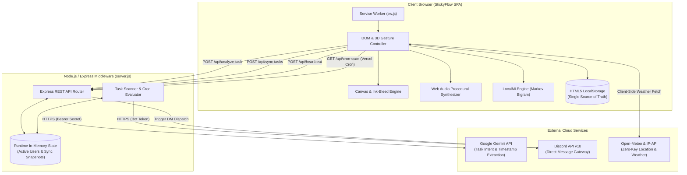

[English](README.md) | [简体中文](README.zh-CN.md)

# StickyFlow · 流笺

> A skeuomorphic digital sticky note application engineered with physical paper dynamics, real-time procedural audio synthesis, offline-first client-side predictive typing, and an AI-driven dual-channel notification pipeline.

[](https://stickyflow-liujian.vercel.app/)
[](LICENSE)
[](https://nodejs.org/)
[](https://developer.mozilla.org/en-US/docs/Web/JavaScript)
[](https://developer.mozilla.org/en-US/docs/Web/API/Web_Audio_API)

---

## Project Overview

**StickyFlow (流笺)** reimagines everyday digital note-taking by synthesizing the tactile intimacy of physical stationery with modern web engineering and ambient intelligence. Built upon an "irreversible ink and paper" philosophy (*落子无悔*), StickyFlow deliberately eliminates artificial digital friction—endless editing, nested folders, and formatting clutter—in favor of spontaneous focus, sensory feedback, and zero-latency capture.

Behind its minimalist, glassmorphic aesthetic lies an expressive client architecture:
- **Zero-asset procedural audio**: Real-time sound synthesis powered entirely by the Web Audio API without loading external audio samples for interaction sounds.
- **Physics and haptic interactions**: Damped harmonic oscillator springs, 3D gyroscope-driven LERP parallax, dynamic peel resistance, and procedural V-notch paper tear fractures.
- **Local ML Predictive Text**: An offline-first Markov Bigram language model running directly in the browser to deliver inline ghost autocompletion.
- **Dual-Channel Ambient Reminders**: A lightweight Node.js/Express middleware connecting Google Gemini AI (structured JSON parsing) to dispatch browser Web Push notifications when online, or headless Discord DMs when offline.

---

## Problem Statement

Modern productivity applications (e.g., Notion, Apple Notes, Todoist) suffer from creeping complexity. Users often experience cognitive fatigue from:
1. **Digital Perfectionism**: Infinite undo/redo, complex markdown hierarchies, and rich text editors lead to over-formatting rather than focused thinking.
2. **Cold, Lifeless Interfaces**: Flat UI design strips away the tactile satisfaction that makes physical stationery enjoyable and memorable.
3. **The Stationery Dilemma**: Physical sticky notes provide rapid focus, physical doodling, and high spatial visibility, but lack cross-device accessibility, searchability, and proactive alerting.

**StickyFlow** bridges this divide. It delivers the genuine sensory delight of paper—ink bleed diffusion, 3D paper stack thickness, authentic tearing sounds, and organic card aging—while augmenting it with local intelligence and cross-platform notification dispatch.

---

## Key Features

### 1. 3D Skeuomorphic Paper Pad & Physics Gestures
- **21-Layer Dynamic Stack**: A rendered 21-sheet base creates an authentic sense of physical depth.
- **Idle Breathing Fold**: The bottom-right page fold (`#pad-fold`) performs a subtle 6-second periodic 3D breathing cycle along its base axis when idle.
- **Peel Resistance Force**: Pulling the note upward engages an exponential resistance model across the first 40px, simulating adhesive tape peel tension before releasing with haptic vibration and procedural audio.
- **V-Notch Procedural Tearing**: Pulling downward dynamically cuts a real-time `clip-path` tear seam based on touch coordinates and pull velocity, splitting the note into two physically distinct 3D polygon fragments that flutter away along parabolic arcs.
- **Damped Harmonic Spring-Back**: When gesture thresholds (80px) are not reached, the note springs back to equilibrium using a damped harmonic oscillator formula (`x(t) = A * sin(ωt) * exp(-γt)`), avoiding rigid linear CSS transitions.
- **3D Parallax Gyroscope (Mobile)**: Listens to iOS/Android `DeviceOrientationEvent` with an exponential low-pass filter (LERP factor `0.06`) to smoothly tilt the note and cast real-time responsive shadows.

### 2. Dual-Engine Canvas Doodling & Pressure Ink
- **Speed-to-Pressure Dynamics**: Translates pointer drag velocity into virtual stylus pressure, smoothly interpolating stroke widths between `0.3x` and `1.3x`.
- **SVG Fractal Noise Ink Bleed**: Integrates an invisible SVG filter (`#ink-bleed`) combining `feTurbulence`, `feDisplacementMap`, and `feGaussianBlur` to simulate the capillary diffusion of wet ink into coarse paper fibers.
- **Handwriting Typography**: Ships with embedded Google Fonts (`Caveat` for English script and `Ma Shan Zheng` for traditional Chinese brushwork).

### 3. Zero-Bandwidth Procedural Sound Synthesizer (`SoundEngine`)
Built strictly with the **Web Audio API** (`AudioContext`, `BiquadFilterNode`, `GainNode`, and algorithmic noise generators):
- `playFly()`: High-gain white noise swept through a bandpass filter from 400Hz to 5800Hz with exponential decay (crisp paper whoosh).
- `playTear()`: 16Hz low-frequency modulation paired with high-frequency stochastic fiber fracture pulses and a resonant frequency slide (3200Hz to 1100Hz).
- `playTypewriter()`: Mid-frequency acoustic cavity resonance (320Hz–400Hz) producing a muted mechanical key click.
- `playPeel()`, `playPageFlip()`, `playPaperDrop()`: Procedurally synthesized adhesive release and physical paper impacts.
- **Ambient Microclimate Synthesizer**: Implements the Voss-McCartney 1/f pink noise algorithm for continuous ambient rain, coupled with low-pass distant thunder rumbles and algorithmic morning birdsong.

### 4. Client-Side Offline Language Model (`LocalMLEngine`)
- **Privacy-First Markov Bigram Engine**: Runs 100% locally in the browser with zero external network overhead.
- **Incremental Corpus Learning**: Automatically tokenizes and trains on the user's historical notes stored in `localStorage`.
- **Ghost Autocompletion**: Predicts word completions and prefix continuations in real time, rendering inline ghost text that can be accepted instantaneously with `Tab`.

### 5. Dual-Layer Glass & Dynamic Weather Engine
- **Three Material Shaders**: Frosted glass (`backdrop-filter: blur(22px)`), Translucent glass, and Liquid glass.
- **Dual-Layer Canvas Simulation**:
  - *Backdrop Canvas*: Renders angled precipitation streaks (-0.15 rad) behind the glass with randomized lightning flash overlays.
  - *Surface Canvas*: Renders 3D refraction water beads on the front glass surface with specular crescent highlights, gravity-driven S-curve sliding, and evaporating trails.
- **Zero-Key Weather Auto-Sync**: Queries `ipapi.co` for user coordinates and synchronizes local conditions via the Open-Meteo REST API.

### 6. The Time Board (时光贴板) & Irreversible History
- **Organic Archival Grid**: Top pull-down board organizes archived notes with randomized tilt angles (-3° to +3°).
- **Time-Based Paper Aging**: Dynamically evaluates the creation timestamp to apply realistic `sepia` and brightness decay filters over time.
- **Irreversible Philosophy**: Notes pulled from the Time Board are strictly read-only (`contenteditable=false`, interaction locked), reinforcing the principle that past history cannot be retroactively edited.

### 7. Dual-Channel AI Reminder Pipeline
- **Natural Language Parsing**: Sends note text to Google Gemini via the backend middleware, parsing fuzzy dates (e.g., *"remind me to call Mom in 20 minutes"*) into structured target timestamps and empathetic alert copy.
- **Intelligent Dispatch**:
  - *Online (Browser Active)*: Dispatches low-latency native HTML5 / Service Worker Web Push notifications.
  - *Offline (Browser Closed)*: Automatically shifts to the Discord Bot REST API to deliver direct private messages (DMs) to the user's bound Discord ID.

---

## Technology Stack

| Domain | Technology / Library | Architectural Role |
| :--- | :--- | :--- |
| **Frontend Runtime** | Vanilla ES6+ JavaScript | Zero-framework application state, gesture engine, DOM controller |
| **Styling & Design** | Modern CSS3 + Tailwind CSS (CDN) | Custom design system (`.pure-clear-glass`), CSS 3D transforms |
| **Graphics & Shaders** | HTML5 Canvas 2D API & SVG Filters | Dual-canvas weather simulation, stroke pressure, ink-bleed filter |
| **Sound Engine** | Web Audio API | Procedural mathematical audio synthesis (zero external audio samples) |
| **Local Intelligence**| Custom Markov Bigram Model | Client-side predictive typing and ghost autocompletion |
| **Backend Middleware**| Node.js 18+, Express.js 4.19 | REST API endpoints, credential containment, notification dispatch |
| **Cloud AI Model** | Google Gemini API (`gemini-3.1-flash-lite`) | Structured JSON extraction of natural language task intents |
| **Bot Messaging** | Discord REST API v10 | Headless offline user notification delivery via private DM |
| **Environmental APIs**| IP-API & Open-Meteo REST API | Client location resolution and real-time weather mapping |
| **Persistence** | HTML5 `localStorage` | Client-authoritative single source of truth for notes & preferences |
| **Deployment** | Vercel Serverless (`@vercel/node`) | Hybrid static frontend asset hosting and serverless API execution |

---

## System Architecture



---

## Project Structure

```text
Sticky365/
├── .env.example             # Safe template for local environment variables
├── .gitignore               # Excludes secrets, node_modules, and cache files
├── app.js                   # Client core: StickyApp, SoundEngine, LocalMLEngine
├── index.html               # Main single-page application entry point
├── manifest.json            # PWA standalone configuration
├── package.json             # Node.js dependencies and script definitions
├── package-lock.json        # Deterministic dependency lockfile
├── README.md                # English technical documentation (Default landing)
├── README.zh-CN.md          # Simplified Chinese technical documentation
├── server.js                # Express backend middleware & Gemini / Discord gateway
├── style.css                # Flow Design System, glassmorphism, keyframe animations
├── sw.js                    # PWA Service Worker for background notification routing
├── vercel.json              # Vercel serverless build and routing configuration
├── docs/
│   └── images/              # Visual assets and application screenshots
└── assets/                  # Media files (audio, logos, background textures)
```

---

## Installation and Setup

### Prerequisites
- **Node.js**: Version `18.0.0` or higher
- **npm**: Version `9.0.0` or higher
- *(Optional)* Google Gemini API Key from [Google AI Studio](https://aistudio.google.com/)
- *(Optional)* Discord Bot Token from [Discord Developer Portal](https://discord.com/developers/applications)

### Step 1: Clone the Repository
```bash
git clone https://github.com/JWBourbon/stickyflow.git
cd stickyflow
```

### Step 2: Install Dependencies
```bash
npm install
```

### Step 3: Configure Environment Variables
Copy the template file to `.env`:
```bash
cp .env.example .env
```
Edit `.env` and supply your credentials:
```env
PORT=3000
GEMINI_API_KEY=your_actual_gemini_api_key
DISCORD_BOT_TOKEN=your_actual_discord_bot_token
```

> [!NOTE]
> StickyFlow's core note-taking, canvas sketching, procedural audio, weather simulation, and local ML autocompletion work completely offline without external API keys. API keys are only required for cloud AI task extraction and Discord DM notifications.

---

## Environment Variables

| Variable Name | Required | Default | Description |
| :--- | :---: | :---: | :--- |
| `PORT` | Optional | `3000` | Port on which the local Express server listens. |
| `GEMINI_API_KEY` | Optional | `""` | Google AI Studio API key for structured task analysis (`gemini-3.1-flash-lite`). |
| `DISCORD_BOT_TOKEN` | Optional | `""` | Discord Bot authentication token used to dispatch offline direct messages. |

---

## How to Run Locally

### Development Mode
```bash
npm run dev
# or: node server.js
```

Once started, open your browser and navigate to:
```text
http://localhost:3000
```

### Verification Checklist
1. Click the central sticky pad to type or sketch.
2. Drag the pad **upward** (>80px) to verify the flying archive animation into the top Time Board.
3. Drag the pad **downward** (>80px) to verify the procedural V-notch tear fracture animation and sound.
4. Open the top Time Board by pulling the top handle downward or clicking the three-dot indicator.
5. In the settings drawer, test audio synthesis and weather simulation modes.

---

## Screenshots and Live Demo

### Live Deployment
The project is configured for continuous deployment on Vercel:
- **Live URL**: [https://stickyflow-liujian.vercel.app/](https://stickyflow-liujian.vercel.app/)

### Core Screens to Capture (`docs/images/`)
Recommended captures demonstrating engineering depth:
1. `docs/images/main-pad-view.png`: Central 3D sticky pad, 21-sheet paper base, folded corner breathing animation, and pen toolset.
2. `docs/images/drag-gestures.png`: Active upward archive gesture and downward procedural V-notch tearing fracture.
3. `docs/images/time-board.png`: Archival Time Board view with organic card rotations (-3° to +3°) and color-coded AI status tapes.
4. `docs/images/weather-simulation.png`: Dual-layer glass microclimate with dynamic canvas raindrops, refracted water beads, and lightning.
5. `docs/images/ai-reminder-flow.png`: Natural language task parsing via Gemini API and dual-channel Web Push / Discord alert dispatch.
6. `docs/images/mobile-experience.png`: Responsive mobile view with bottom tool drawer and 10vh virtual keyboard collision dodge.

---

## Development Status

### Implemented and Verified Working
- [x] Full single-page vanilla JS state management and component lifecycle.
- [x] 3D layered paper pad with 21 sheets and dynamic idle fold breathing animation.
- [x] Canvas freehand doodle engine with speed-based stroke pressure interpolation.
- [x] SVG fractal noise ink diffusion filter (`#ink-bleed`).
- [x] Upward flick archive gesture with parabolic trajectory and landed damping.
- [x] Downward pull tearing gesture with touch-relative V-notch `clip-path` fracture and dual polygon splitting.
- [x] Damped harmonic oscillator equation replacing static CSS transitions.
- [x] Complete zero-bandwidth procedural sound synthesizer via Web Audio API (7 custom sound profiles + weather ambient noise).
- [x] Client-side Markov Bigram predictive text engine (`LocalMLEngine`) with ghost completion.
- [x] Dual-layer dynamic weather canvas (backdrop precipitation + front glass refracted sliding drops).
- [x] IP geolocation and Open-Meteo real-time environmental synchronization.
- [x] Archival Time Board with organic angles, dynamic sepia aging, and read-only inspection.
- [x] Backend Express middleware with Google Gemini API structured JSON task parsing.
- [x] Dual-channel notification system: HTML5/Service Worker Web Push (online) + Discord Bot DM (offline).
- [x] PWA standalone support (`manifest.json` + `sw.js`).
- [x] Responsive mobile UI with bottom tool drawer and 10vh soft-keyboard upward displacement.

### Partially Implemented & Architectural Constraints
- [!] **Serverless In-Memory State**: The backend middleware maintains active user tasks in memory (`userTasks`). While client synchronization (`/api/sync-tasks`) keeps tasks aligned during active sessions, long periods of client inactivity across serverless cold starts can benefit from persistent database storage.
- [!] **No Partial Eraser / Undo**: Intentionally excluded by product design ("落子无悔" - irreversible recording); each note must either be saved in full or destroyed in full.

### Planned Improvements
- [ ] **Distributed Task Queue**: Integration with Upstash Redis or Supabase for persistent serverless cron reminders across container shutdowns.
- [ ] **End-to-End Encrypted Cloud Sync**: Multi-device sync using WebRTC or CRDTs (Conflict-free Replicated Data Types).
- [ ] **Handwriting OCR**: Client-side WebAssembly OCR (e.g., Tesseract.js) to convert sketched notes into searchable text.
- [ ] **Custom Paper Shaders**: Additional procedural paper texture shaders (parchment, kraft paper, washi paper).

---

## License

This project is licensed under the [MIT License](LICENSE).
