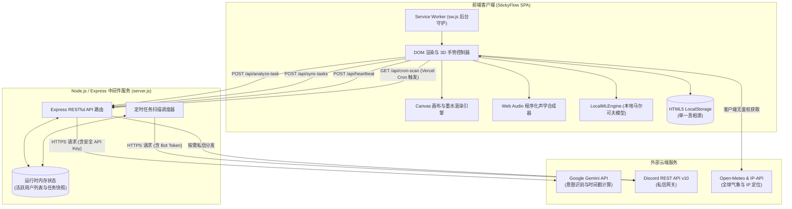

[English](README.md) | [简体中文](README.zh-CN.md)

# StickyFlow · 流笺

> 融合纸张物理动力学、实时程序化声学合成、离线本地语言模型预测输入与 AI 驱动双渠道跨端提醒的拟物数字流笺应用。

[](https://stickyflow-liujian.vercel.app/)
[](LICENSE)
[](https://nodejs.org/)
[](https://developer.mozilla.org/zh-CN/docs/Web/JavaScript)
[](https://developer.mozilla.org/zh-CN/docs/Web/API/Web_Audio_API)

---

## 项目概述 (Project Overview)

**StickyFlow（流笺）** 是一款追求极致拟物触感、声学美学与现代 Web 工程深度的单页便签应用。项目贯彻“**落子无悔**”的实体纸笔书写理念，摒弃传统笔记软件冗余的多层级目录、复杂的富文本工具栏与反复修改撤销，回归记录的纯粹专注与即时心流。

在极简通透的液态毛玻璃（Glassmorphism）视觉之下，StickyFlow 拥有硬核的前端工程架构：
- **零带宽程序化音频引擎**：完全基于 Web Audio API 进行数学实时波形合成，无需加载静态音频文件即可产生清脆的交互音效。
- **物理触觉与手势动力学**：实现阻尼谐振子弹性回弹、iOS 陀螺仪 LERP 平滑视差、初始粘胶阻抗与手指接触点沿受力方向的程序化 V-notch 撕裂切分。
- **端侧离线语言模型 (Local ML)**：在浏览器端构建轻量级马尔可夫二元语法（Markov Bigram）模型，100% 离线实现幽灵文字（Ghost Text）预测补全。
- **AI 赋能双渠道提醒管道**：Node.js/Express 中间件调用 Google Gemini API 进行自然语言任务提取，结合网页在线的浏览器 Web Push 与离线无界面的 Discord Bot 私信推送。

---

## 问题陈述 (Problem Statement)

当代任务与笔记工具（如 Notion、Apple Notes、Todoist）功能日益繁复，但也带来了新的认知负担：
1. **数字完美主义内耗**：无休止的排版撤销、复杂的看板与关系型数据库，使用户将精力浪费在工具组织而非内容思考本身。
2. **扁平冷峻的交互体验**：过度简化的 Flat UI 剥离了物理文具特有的纸张阻尼感、撕裂解压感与空间视觉记忆。
3. **传统实体便利贴的数字断层**：实体便利贴随手涂鸦、即撕即贴极其高效，但缺乏跨设备流转、检索归档与主动定时提醒能力。

**StickyFlow** 正是为解决这一矛盾而生：它既保留实体便签的物理真实感（墨水纸张洇染、多层纸堆厚度、撕纸音效、老化泛黄滤镜），又赋予其现代轻量级 AI 自然语言识别与跨终端通知能力。

---

## 核心特性 (Key Features)

### 1. 3D 拟物便签纸堆与物理手势动力学
- **21 层拟物叠纸底座**：页面中央渲染具有真实实体厚度的 21 层叠纸底座，强化三维拟物沉浸感。
- **闲置微风呼吸折角**：便签右下角折角（`#pad-fold`）在闲置未编辑状态下，以底边为基准轴进行周期为 6 秒的 3D 微幅轻风起伏呼吸。
- **粘胶剥离阻抗 (Peel Resistance)**：向上拖拽前 40px 内引入指数级递增的物理阻抗力，模拟背胶剥离时的黏附受力，超过阈值后瞬间脱开并触发触觉震动与解胶声效。
- **接触点 V-notch 程序化撕纸分裂**：向下撕扯时，系统根据手指触点横向坐标（`dragStartRelX`）与拉拽向量，实时计算 `clip-path` 撕裂折缝与纤维锯齿；超过 80px 阈值后沿裂痕物理切开，克隆分裂成左、右两片独立的 3D 多边形碎片，各自沿抛物线抛射飘落。
- **阻尼谐振子弹性回弹**：拖拽距离未达阈值松手时，弃用生硬的 CSS 线性过渡，采用纯物理阻尼谐振子公式（$x(t) = A \cdot \sin(\omega t) \cdot e^{-\gamma t}$）进行逐帧多频弹性抖动归位。
- **移动端 3D 陀螺仪 LERP 视差**：监听移动端 `DeviceOrientationEvent`，引入系数为 `0.06` 的线性插值（LERP）平滑滤波，跟随手机倾斜角度实时偏转卡片并映射深层动态阴影。

### 2. 双模式画布涂鸦与压感笔迹引擎
- **速度-虚拟压感动态插值**：Canvas 涂鸦时根据手指/光标移动速度实时解算虚拟墨水压感，笔触宽度在 `0.3x` 至 `1.3x` 之间自然渐变（慢则丰满洇润，快则纤细飞白）。
- **SVG 分形噪点墨水洇染滤镜**：引入隐式 SVG 滤镜（`#ink-bleed`），整合 `feTurbulence`（分形噪点）、`feDisplacementMap`（位移扰动）与 `feGaussianBlur`（高斯微模糊），高度仿真湿墨渗入粗糙纸张纤维的微观毛细扩散效应。
- **书法与手写字重现**：原生内置 Google Fonts `Caveat`（西文手绘手写体）与 `Ma Shan Zheng`（中文毛笔马山正体）。

### 3. 零带宽程序化声学合成器 (`SoundEngine`)
完全基于 **Web Audio API** 原生底层节点（`AudioContext`、`BiquadFilterNode`、`GainNode`、算法白噪/粉噪缓冲），无需外置音频资源：
- `playFly()`：高通-带通带扫频白噪声（400Hz 快速拉升至 5800Hz，Q 值 2.2），结合 0.48 强增益指数衰减，合成清脆饱满的纸张飞逝声。
- `playTear()`：16Hz 低频正弦阻力调制 + 随机高频纤维崩断脉冲 + 谐振频点从 3200Hz 快速下探至 1100Hz，完美还原撕纸“撕拉”声。
- `playTypewriter()`：中频（320Hz~400Hz）木质腔体共鸣正弦衰减，模拟内敛沉稳的红轴机械键帽敲击声。
- `playPeel()`, `playPageFlip()`, `playPaperDrop()`：纯数学合成的不干胶分子键断裂粘滞声、轻柔翻纸刮擦声与纸张落堆撞击声。
- **环境微气候声学生成器**：采用 Voss-McCartney 算法实时生成粉红噪声（Pink Noise）作为环境雨声基底，辅以低通远雷轰鸣与清晨正弦波连续鸟叫扫频。

### 4. 纯端侧离线预测语言模型 (`LocalMLEngine`)
- **零网络隐私优先**：100% 运行于浏览器端，不上传任何打字内容。
- **增量历史语料训练**：自动从 `localStorage` 读取用户历史记录并分词，构建全局词频字典与前缀马尔可夫二元转移矩阵（Markov Bigram）。
- **实时幽灵文字补全 (Ghost Text)**：根据当前输入状态预测后继词或前缀自动补全，在光标处呈现幽灵占位，按下 `Tab` 键一秒采纳。

### 5. 双层玻璃与动态微气候气象引擎
- **三种材质光照着色**：毛玻璃（厚重高斯模糊 `blur(22px)`）、通透玻璃与液态高光玻璃。
- **双层 Canvas 仿真渲染**：
  - *玻璃背后层*：渲染 -0.15 弧度斜下落雨丝粒子与随机闪电高光。
  - *玻璃前表面*：渲染 3D 折射晶莹水珠（带有月亮弯反光高光与软投影），模拟重力下滑、正弦阻力微扰 S 形摆动与留痕蒸发机制。
- **无感真实天气映射**：调用 `ipapi.co` 解析 IP 经纬度，调用 Open-Meteo REST API 自动同步当地气象与昼夜状态。

### 6. 时光贴板 (Time Board) 与“落子无悔”哲学
- **有机散落式归档**：顶部下拉贴板陈列已保存的卡片，自动注入 `-3deg` 至 `+3deg` 的微幅随机旋转角度，模拟自然散落形态。
- **时间老化物理滤镜**：根据创建时间距今跨度，动态计算老化因子，叠加复古 `sepia` 棕褐滤镜与亮度衰减，呈现岁月质感。
- **落子无悔只读原则**：从贴板拉回中央的历史旧便签强制封死交互编辑（`contenteditable=false`），仅允许查看、重新归档或撕毁，杜绝事后篡改。

### 7. AI 任务提取与双渠道通知系统
- **自然语言任务解析**：便签文本提交后端 Express 服务，通过 Google Gemini API（JSON 模式）自动识别任务属性，提取待办事件、相对时间偏移与精准 Unix 时间戳。
- **智能分流触达**：
  - *网页活跃在线*：以极低延迟唤起原生 HTML5 / Service Worker Web Push 系统通知。
  - *网页关闭离线*：无感切换至 Discord Bot REST API，向用户绑定的 Discord ID 发送点对点私信提醒。

---

## 技术栈详解 (Technology Stack)

| 领域 | 核心技术 / 库 | 架构角色与实现细节 |
| :--- | :--- | :--- |
| **前端运行时** | 原生 ES6+ JavaScript | 无前端框架依赖，纯类驱动（`StickyApp`, `SoundEngine`, `LocalMLEngine`） |
| **样式与视觉规范**| CSS3 原生变量 + Tailwind CSS (CDN) | Flow 拟物规范、`.pure-clear-glass` 液态玻璃规范、3D 变换 |
| **图形渲染** | HTML5 Canvas 2D API & SVG 滤镜 | 双层微气候粒子、水滴折射、笔刷动态压感、`feDisplacementMap` 墨水扩散 |
| **音频合成** | Web Audio API | 纯数学公式程序化生成全部交互音效与环境雨声，0MB 外置音频资产依赖 |
| **端侧算法** | 原生 JS 马尔可夫二元语法模型 | 纯本地运行的词频统计、上下文词对转移与幽灵文字预测补全 |
| **服务端中间件** | Node.js 18+, Express.js 4.19 | REST API 路由控制、API 密钥隔离防护、离线任务分发网关 |
| **云端大模型** | Google Gemini API (`gemini-3.1-flash-lite`) | 严格 JSON 约束下的自然语言待办事件抽取与治愈系文案润色 |
| **即时通讯网关** | Discord REST API v10 | 基于 Bot Token 的私信频道建立与离线消息代发 |
| **环境气象服务** | IP-API + Open-Meteo REST API | 免 Key 免鉴权的用户定位与全球气象数据自动映射 |
| **本地持久化** | HTML5 `localStorage` | 客户端单一数据真相源（Single Source of Truth），绝不强制绑定远程数据库 |
| **部署托管** | Vercel Serverless (`@vercel/node`) | 静态资源与 Serverless API 混合托管，集成 Vercel Cron 定时扫描 |

---

## 系统架构 (System Architecture)



---

## 目录结构 (Project Structure)

```text
Sticky365/
├── .env.example             # 环境变量安全示例模板（严禁直接提交真实 .env）
├── .gitignore               # Git 忽略配置（排除凭证、node_modules 与临时缓存）
├── app.js                   # 前端核心业务逻辑（StickyApp, SoundEngine, LocalMLEngine）
├── index.html               # 单页应用主结构与 SVG 滤镜定义
├── manifest.json            # PWA 渐进式应用配置文件
├── package.json             # 依赖声明与启动脚本
├── package-lock.json        # 依赖项确定性版本锁定文件
├── README.md                # 英文专业技术文档（GitHub 默认主页）
├── README.zh-CN.md          # 简体中文专业技术文档
├── server.js                # Express 后端服务中间件与 Gemini/Discord 网关
├── style.css                # Flow 设计系统、玻璃拟物样式、核心关键帧动画
├── sw.js                    # Service Worker 后台通知管理管道
├── vercel.json              # Vercel 静态托管与 Node 运行时无缝路由配置
├── docs/
│   └── images/              # 项目视觉资产与界面展示截图归档目录
└── assets/                  # 静态多媒体资源（背景、图标等）
```

---

## 安装与配置 (Installation and Setup)

### 环境要求
- **Node.js**: `18.0.0` 或更高版本
- **npm**: `9.0.0` 或更高版本
- *(可选)* Google Gemini API Key（前往 [Google AI Studio](https://aistudio.google.com/) 免费申请）
- *(可选)* Discord Bot Token（前往 [Discord Developer Portal](https://discord.com/developers/applications) 申请）

### 第一步：克隆代码仓库
```bash
git clone https://github.com/JWBourbon/stickyflow.git
cd stickyflow
```

### 第二步：安装项目依赖
```bash
npm install
```

### 第三步：配置本地环境变量
复制模板文件以创建本地私有 `.env`：
```bash
cp .env.example .env
```
使用文本编辑器打开 `.env` 并填写对应凭证：
```env
PORT=3000
GEMINI_API_KEY=你的真实Gemini密钥
DISCORD_BOT_TOKEN=你的真实Discord机器人Token
```

> [!NOTE]
> StickyFlow 的核心记事、涂鸦绘画、程序化声学合成、微气候物理模拟与离线本地预测输入无需任何 API 密钥即可完全离线运行。仅在使用 Gemini 智能任务识别与 Discord 离线私信时需要配置相应环境变量。

---

## 环境变量说明 (Environment Variables)

| 变量名称 | 是否必填 | 默认值 | 详细作用说明 |
| :--- | :---: | :---: | :--- |
| `PORT` | 否 | `3000` | 本地 Express 监听端口号。 |
| `GEMINI_API_KEY` | 否 | `""` | 用于自然语言待办解析的 Google Gemini API 凭证（使用 `gemini-3.1-flash-lite` 模型）。 |
| `DISCORD_BOT_TOKEN` | 否 | `""` | 用于向离线用户发送定时提醒私信的 Discord 机器人 Bot 凭据。 |

---

## 本地启动与调试 (How to Run Locally)

### 启动服务
```bash
npm run dev
# 或直接运行: node server.js
```

启动成功后，使用现代浏览器访问：
```text
http://localhost:3000
```

### 核心功能测试清单
1. 点击中央便签纸，输入文字或使用画笔模式进行涂鸦。
2. 向上大幅拖拽便签（>80px），测试抛物线飞入顶部贴板动画与飞纸音效。
3. 向下拖拽便签（>80px），测试由手指触点引发的 V-notch 真实撕纸裂痕与双片碎裂动画。
4. 下拉顶部把手唤出时光贴板，查看旧便签的老化泛黄质感与不可编辑保护机制。
5. 展开右下角气象控制面板，测试雨丝、水滴折射微气候与程序化白噪音合成。

---

## 界面展示与在线体验 (Screenshots and Live Demo)

### 线上预览
本项目已配置 Vercel 持续集成部署：
- **在线演示地址**: [https://stickyflow-liujian.vercel.app/](https://stickyflow-liujian.vercel.app/)

### 推荐关键捕获截屏 (`docs/images/`)
为展现项目的工程细节，推荐在不同分辨率下捕获以下关键场景并归档：
1. `docs/images/main-pad-view.png`：中央 3D 便签、21 层拟物叠纸、闲置折角呼吸与侧边栏工具。
2. `docs/images/drag-gestures.png`：向上飞纸归档动态与向下程序化 V-notch 撕裂切开分裂效果。
3. `docs/images/time-board.png`：时光贴板有机角度倾斜散落视图与彩色 AI 任务胶带标识。
4. `docs/images/weather-simulation.png`：双层玻璃窗外微气候模拟（动态雨丝粒子、3D 凸透折射水滴与闪电高光）。
5. `docs/images/ai-reminder-flow.png`：自然语言任务输入经 Gemini 解析提取并触发 Web Push / Discord 提醒流程。
6. `docs/images/mobile-experience.png`：移动端高定冰箱贴背景、底部抽屉式工具栏与虚拟键盘 10vh 物理避让。

---

## 开发状态与限制 (Development Status)

### 已完整实现并验证的功能
- [x] 基于原生 JavaScript 的单页完整状态机与组件生命周期。
- [x] 21 层拟物纸堆底座与闲置状态下的折角 3D 微风呼吸动效。
- [x] 支持手绘涂鸦的动态速度-压感插值笔刷算法。
- [x] 基于 SVG 分形位移噪点的真实墨水毛细扩散洇染滤镜（`#ink-bleed`）。
- [x] 向上拖拽的抛物线飞纸归档交互与阻尼落地回弹。
- [x] 基于接触点受力分析的程序化 V-notch 撕纸裂口与双多边形撕碎剥离动效。
- [x] 弃用生硬 CSS 过渡、改用纯数学阻尼谐振子方程的平滑物理归位。
- [x] 纯原生 Web Audio API 程序化声学合成引擎（7 套拟物音效 + 算法微气候粉噪雨声）。
- [x] 纯端侧离线马尔可夫二元预测语言模型（`LocalMLEngine`）与幽灵文字补全。
- [x] 双层微气候 Canvas 引擎（玻璃后雨丝粒子 + 玻璃前 3D 水珠折射与 S 弯滑行留痕）。
- [x] 基于 IP 与 Open-Meteo API 的零 Key 自动化环境天气映射。
- [x] 时光贴板有机散落排列、岁月老化滤镜与只读防篡改防护。
- [x] 基于 Google Gemini API 结构化 JSON 的待办事件抽取与温馨文案生成。
- [x] 双渠道通知触达：在线 Web Push 弹窗 + 离线 Discord Bot 私信推送。
- [x] 完整适配 PWA standalone 原生应用形态（`manifest.json` 与 `sw.js`）。
- [x] 移动端 UI 2.0 底部抽屉与 10vh 虚拟软键盘物理向上避让防遮挡。

### 部分实现与架构约束说明
- [!] **Serverless 运行时的内存持久化限制**：后端中间件当前采用内存数据结构存储活跃任务快照（`userTasks`）。在本地环境下持续稳定运行，但在无状态的 Serverless 云函数极端冷启动场景下，若客户端长期彻底离线，未送达任务可能随容器休眠而丢失，建议引入轻量分布式键值库。
- [!] **不可逆记录哲学限制**：产品严格贯彻“落子无悔”设计理念，故意未设置局部撤销与橡皮擦功能，用户只能整页保存或整页销毁。

### 计划演进特性
- [ ] **分布式 Serverless 任务队列**：引入 Upstash Redis 或 Supabase 替代内存任务表，保障无状态冷启动下的跨日定时离线触发。
- [ ] **端到端加密跨设备同步**：基于 WebRTC 或 CRDT（无冲突复制数据类型）实现点对点多端数据加密流转。
- [ ] **手写涂鸦端侧 OCR 识别**：引入轻量级 WebAssembly 文字识别引擎，将手写草稿自动索引转化为可检索数字文本。
- [ ] **多材质纸张着色器**：扩充羊皮纸、牛皮纸、和纸等程序化纤维底纹着色器。

---

## 开源协议 (License)

本项目基于 [MIT 协议](LICENSE) 开源。
